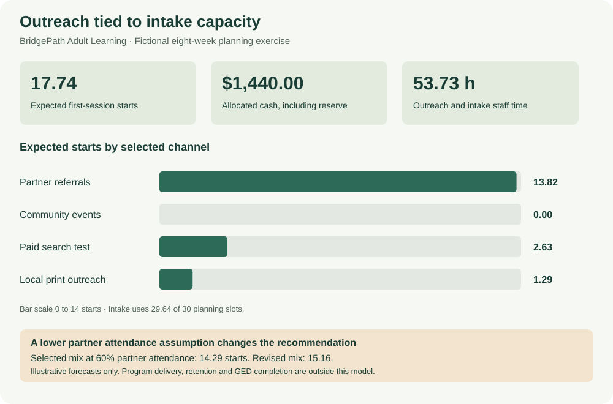

# Nonprofit outreach and intake strategy

**Ziana Bennett · Nonprofit strategy extern, 2024 · Independent portfolio extension, 2026**

My 2024 PwC nonprofit externship with Mercy Education Project involved peer-nonprofit benchmarking, outreach and donor-engagement analysis, and marketing recommendations. This repository extends that experience with a new planning exercise. It asks how much outreach a small education program can support when every inquiry creates follow-up work.

**BridgePath Adult Learning, the organization in this exercise, is fictional.** All budgets, response rates and results below are new planning assumptions or calculations. This is an independent work sample created in November 2026. It was not delivered to Mercy Education Project, and it does not report that organization's results.

Mercy provides useful context for the original experience. Its [Women's Program](https://www.mercyed.net/womens-program) describes free adult basic education and GED preparation, an initial assessment, and learning support tailored to individual needs. Those program features informed the kind of service considered here. They are not evidence for the model's conversion rates.

## The decision

The fictional program has eight weeks, a **$1,500 cash ceiling**, **60 outreach and intake staff hours**, **30 intake appointments** and **24 learner seats**. Instructional delivery is already funded. The objective is to increase first-session attendance while protecting the capacity to respond to interested learners.

The model selects **three partner activations, one $300 paid-search test and one local print round**. It forecasts **17.74 first-session starts**, allocates **$1,440**, and requires **53.73 staff hours**. The cash allocation includes a **$480 learner-support reserve** held for all 24 seats.



The practical constraint is intake scheduling. The selected mix forecasts **29.64 bookings against 30 available appointments**. It leaves very little room for forecast error or rescheduling. The recommendation is a staged pilot with a live calendar check before each additional outreach activity. Spending the full allocation depends on that check.

## What the analysis changes

| Decision | Reasoning |
| --- | --- |
| Measure a first teaching session as the outcome | A contact or booked appointment does not establish that someone began learning. |
| Include time for every inquiry and booked intake | Staff still reserve appointment time when a learner does not attend. |
| Hold learner-support cash before buying outreach | A fuller inquiry funnel should not consume the entire support budget. |
| Keep paid search small | It tests a second acquisition route while limiting demand on intake staff. |
| Review partner attendance before expanding | The recommendation depends strongly on the assumed quality of referrals and attendance. |

The event-led alternative forecasts **17.46 starts** at **$1,470** and **57.35 staff hours**. Its result is close enough that the model does not establish a strong real-world winner. When partner attendance changes from 80% to 60%, the selected mix falls to **14.29 expected starts**. Reallocating toward an event and print outreach produces **15.16** under that same lower-attendance assumption.

These comparisons identify what to measure early. They do not estimate causal impact or the probability of achieving a particular enrollment count.

## Explore the work

| File | What it shows |
| --- | --- |
| [Strategy memo](strategy.md) | Audience choices, sample messaging, channel tradeoffs and the staged rollout |
| [Decision brief](results/decision-brief.md) | Computed recommendation, resource reconciliation and attendance sensitivity |
| [Scenario inputs](data/scenario.json) | Every budget, capacity and funnel assumption |
| [Analysis](analyze.py) | Exact decimal arithmetic and an exhaustive comparison of 144 bounded channel mixes |
| [Machine-readable results](results/analysis.json) | Full-precision totals, alternatives and sensitivity results |
| [Planning-rule tests](test_analyze.py) | Capacity boundaries, no-show time, reserve allocation and invalid inputs |
| [Sources and provenance](sources.md) | The boundary between historical context and this new exercise |

## Reproduce the results

Use Python 3.10 or later. The analysis uses the standard library and requires no packages, API keys or network access.

```bash
python3 analyze.py
python3 -m unittest -v
python3 analyze.py --check
```

The first command regenerates the JSON results, decision brief and SVG. `--check` verifies that all three saved outputs match the current inputs. Counts displayed to two decimals are expected values; the calculation retains their full precision. JSON decimal metrics are stored as strings to preserve that precision.

The strategy memo is written separately from the generated report. If inputs change, review its recommendation and the README alongside the regenerated results. No real learner records, donor records or client materials are included.
